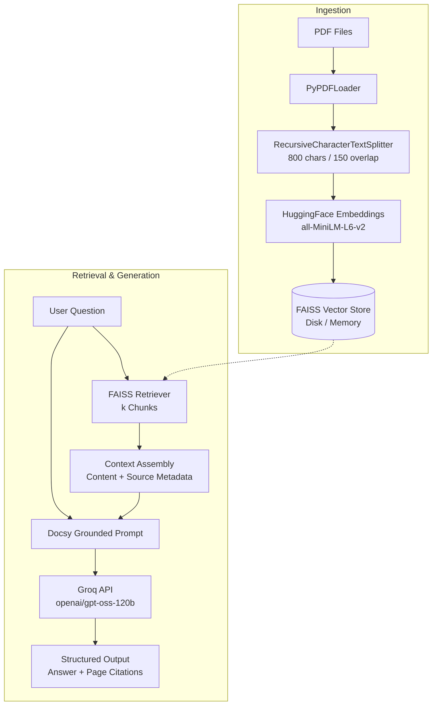

# 📚 Docsy — Grounded Multi-PDF RAG Assistant

Docsy is a high-performance **Retrieval-Augmented Generation (RAG)** system designed to ingest, index, and query single or multiple PDF documents with strict anti-hallucination guardrails and exact page citations. Powered by **LangChain**, **HuggingFace embeddings**, **FAISS**, and **Groq LPUs**, Docsy provides near-instant grounded responses to complex document queries.

---

## 🌟 Key Features

- **Multi-Document Ingestion & Merged Index**: Upload one or multiple PDFs at once. All documents are chunked and indexed into a single searchable FAISS vector space, with source metadata retained for cross-document citations.
- **Ultra-Fast LLM Inference with Groq**: Integrates `ChatGroq` utilizing high-capacity open models (default: `openai/gpt-oss-120b`), achieving sub-second token generation times.
- **Strict Anti-Hallucination Guardrails**: Prompts enforce that answers are derived *strictly* from retrieved chunks. If the document does not contain the answer, Docsy explicitly tells you rather than hallucinating.
- **Page-Level Deduplicated Citations**: Retrieved sources and page numbers are returned separately from the generated answer and organized cleanly in the user interface.
- **Smart Vector Persistence & Staleness Detection**: Disk-persisted FAISS indices with sidecar metadata (`meta.json`) verify file timestamps and sizes, eliminating redundant re-embedding runs.
- **Interactive Streamlit Web Interface**: Features an interactive document catalog, dynamic context chunk slider ($k$), real-time ingestion progress bars, and persistent chat sessions.
- **Thorough 69-Test Test Suite**: Complete unit, integration, and UI test coverage using mocks—ensuring zero API quota consumption during development.

---

## 🏗️ Architecture



---

## 📁 Project Structure

```text
Docsy/
├── app/
│   └── streamlit_app.py        # Streamlit web application
├── data/
│   ├── pdfs/                   # Sample & test documents
│   └── vectorstore/            # Persisted FAISS index & metadata
├── src/
│   ├── ingestion/
│   │   ├── loader.py           # PDF document loading via PyPDFLoader
│   │   └── splitter.py         # Recursive character text splitting
│   ├── embeddings/
│   │   └── embedder.py         # HuggingFace MiniLM embedder (cached)
│   ├── vectorstore/
│   │   └── store.py            # FAISS store creation, disk I/O & staleness detection
│   ├── retrieval/
│   │   └── retriever.py        # Similarity search retriever configuration
│   ├── generation/
│   │   ├── llm.py              # Groq Chat model initialization
│   │   ├── prompt.py           # Grounded RAG prompt template
│   │   └── chain.py            # LangChain RunnableSequence pipeline
│   ├── rag/
│   │   └── pipeline.py         # RAGPipeline orchestration & error handling
│   └── main.py                 # CLI orchestration entrypoint
├── tests/
│   ├── test_loader.py          # PDF loader tests
│   ├── test_splitter.py        # Document chunking tests
│   ├── test_vectorstore.py     # FAISS creation & persistence tests
│   ├── test_retrieval.py       # Similarity search tests
│   ├── test_generation.py      # Prompt & chain tests
│   ├── test_pipeline.py        # RAG pipeline orchestration & error handling tests
│   └── test_ui.py              # Streamlit AppTest interaction tests
├── .env.example                # Example environment variables
├── pyproject.toml              # Project dependencies & tool configurations
└── README.md
```

---

## 🚀 Getting Started

### 1. Prerequisites
- Python 3.12+
- [`uv`](https://github.com/astral-sh/uv) (recommended) or `pip`
- A free [Groq API Key](https://console.groq.com/keys)

### 2. Installation

Clone the repository and install dependencies:

```bash
git clone https://github.com/Lucifer2987/Docsy.git
cd Docsy

# Install dependencies using uv
uv sync
```

### 3. Configure Environment Variables

Create a `.env` file in the project root:

```env
GROQ_API_KEY=gsk_your_groq_api_key_here

# Optional: override default model (default: openai/gpt-oss-120b)
# GROQ_MODEL=openai/gpt-oss-120b
```

---

## 💻 Usage

### Run the Web Application (Streamlit)

Launch the interactive web UI:

```bash
uv run streamlit run app/streamlit_app.py
```

Open `http://localhost:8501` in your browser. From here you can:
1. Upload one or more PDF files via the sidebar.
2. Watch real-time ingestion and chunking progress.
3. Adjust the **Context Chunks ($k$)** slider to tune retrieval depth.
4. Ask questions and inspect exact page citations in the sources expander.

### Run the CLI Pipeline

You can also run the pipeline directly from the command line:

```bash
uv run src/main.py
```

---

## 🧪 Testing

Docsy includes a comprehensive test suite of **69 tests**. All tests use local mocking so they execute deterministically in seconds **without consuming API credits**:

```bash
uv run pytest
```

---

## ⚙️ Engineering Highlights

- **Provider Resilience**: Custom error wrapper distinguishes between transient 5xx server issues, 429 rate limits, and network errors, providing human-readable troubleshooting guidance.
- **Deduplicated Embedding Model**: Embedder model instances are cached via singleton to eliminate redundant memory overhead and model re-downloads.
- **Provable Grounding**: Output structure cleanly separates the generated prose from document metadata, ensuring citations can be verified against the raw text.

---

## 📜 License

This project is licensed under the MIT License.
